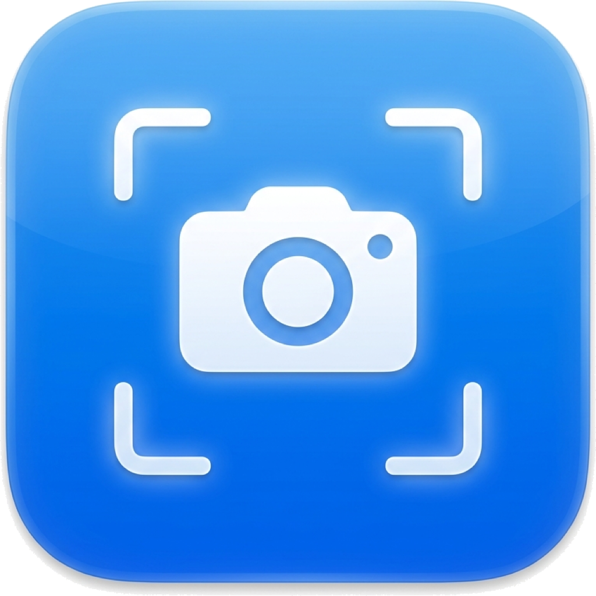
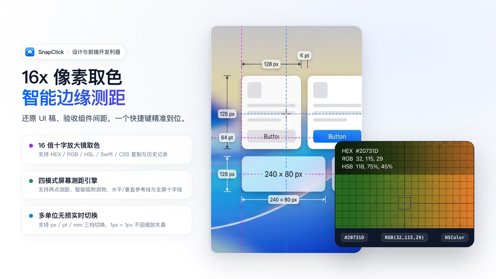
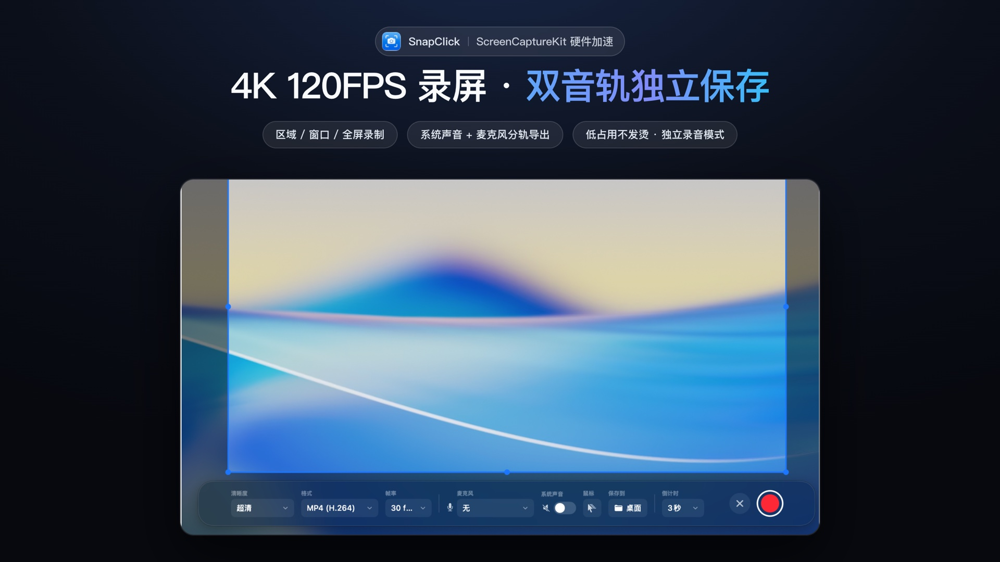
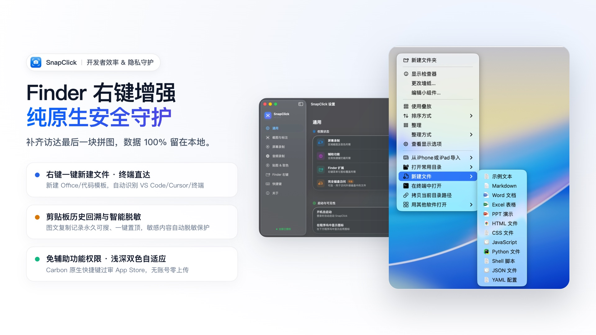

# SnapClick

### macOS 一体化原生桌面效率套件 — 桌面灵动岛 · 截图标注 · 4K 录屏 · 本地 OCR · 取色测距 · 访达右键

 

  

告别臃肿的菜单栏与重复的高价订阅。**SnapClick** 使用纯原生 Swift / SwiftUI 打造，将 **Mac 桌面灵动岛（SnapIsland）、AI 无痕擦除截图标注、长截图导出可搜索 PDF、本地 OCR 翻译、4K 120FPS 硬件加速录屏、16x 像素取色测距、剪贴板历史与 Finder 右键增强** 融为一体。**现已正式上架 Mac App Store，支持苹果官方沙盒认证与自动更新。**

[全景对比](#-一表看懂以一敌八) · [核心功能](#-核心功能) · [技术与隐私](#-技术亮点与隐私守护) · [下载安装](#-下载安装) · [联系作者](#-联系作者与反馈)

**简体中文** | [English](README_EN.md)

 

---

## 📊 一表看懂：以一敌八

| 核心模块 | 覆盖的高频效率场景 | 可替代的传统独立工具 |
| --- | --- | --- |
| **SnapIsland 桌面灵动岛** | 七大工作台（主页 / 金融行情 / 文件暂存 / 照镜子 / 终端 / 系统监控 / AI 对话）+ 灵动弹窗 + 锁屏控台 | Alcove / Boring Notch / Dropover |
| **专业截图标注 & AI 擦除** | 智能/选区/窗口/长截图、14 种标注、聚光灯、防盗水印、AI 无痕擦除文字、双层可搜索 PDF | CleanShot X / Snipaste / Xnip |
| **本地 OCR & 离线翻译** | 100% 本地屏幕识字、离线即时翻译、二维码识别 | TextSniper / Bob |
| **4K 120FPS 录屏 & 录音** | ScreenCaptureKit 硬件加速、区域/窗口/全屏录制、系统内录 + 麦克风双音轨独立保存 | Kap / ScreenFlow / QuickTime |
| **16x 取色 & 像素测距** | 十字放大镜取色（HEX/RGB/HSL/Swift/CSS）+ 测距 / 测物边缘吸附 / 参考线 / 十字线 | ColorSlurp / Sip / PixelSnap |
| **Finder 访达右键增强** | 右键新建 Office/Markdown/代码模板、剪切粘贴、路径拷贝、一键直达终端 / VS Code / Cursor / Xcode | XtraFinder / 超级右键 |
| **剪贴板历史 & 屏幕贴图** | 图文复制记录永久回溯与置顶、敏感信息智能脱敏、多视窗跨 Space 屏幕贴图 | Paste / Maccy |

---

## ✨ 核心功能

### 🏝️ SnapIsland Mac 桌面灵动岛

将 MacBook 屏幕顶部刘海与菜单栏区域升级为全能桌面效率中枢：

- **截图钉上岛 & 文件暂存架**：截图完成后一键钉入灵动岛，或直接拖拽文件入岛暂存；跨应用拖出即用，支持一键隔空投送（AirDrop）。
- **七大工作台 + AI 智能随航**：悬停或快捷键展开，一键切换 **主页、金融行情（自选股/大盘实时追踪）、文件暂存、照镜子、快捷终端、系统状态监控、AI 智能对话**（支持多模型切换、代码推理与语音输入）。
- **灵动状态感知与锁屏控台**：优雅接替生硬的系统音量/亮度弹窗，呈现耳机电量与音乐声波；支持锁屏灵动岛（空格键快捷切歌，智能检测密码输入并自动退让焦点），内置桌面萌宠挂件。

---

### 📸 专业截图标注 · AI 无痕擦除 · 本地 OCR

- **四大独立截图模式**：智能截图（自动贴合悬停窗口）、自由选区、指定窗口与自动滚动无缝长截图。
- **14 种高频标注工具**：矩形、椭圆、箭头、文字、画笔、步骤序号、像素级马赛克、**聚光灯聚焦**、**文字/Logo 45° 防盗水印**与高清贴纸，支持毛玻璃阴影与圆角美化包装。
- **AI 智能擦除与替换**：局部涂抹即可自动还原背景纹理，无痕去除敏感信息或杂物。
- **双层可搜索矢量 PDF**：长截图与文档截图支持导出内嵌文字层的 PDF，直接支持 `⌘F` 关键词检索与划选复制。
- **100% 本地 OCR 与离线翻译**：断网可用，一键提取并翻译屏幕任意区域文字与二维码，隐私数据绝不上传云端。

---

### 🎨 16x 精准取色放大镜 & 像素级智能测距

前端开发、iOS/macOS 工程师与 UI 设计师的桌面标尺：

- **16x 像素级十字取色**：精准放大屏幕像素，支持 **HEX、RGB、HSL、Swift (NSColor)、CSS** 一键复制，自动记录最近取色历史。
- **四模式屏幕测距引擎**：提供 **测距模式（两点距离）**、**测物模式（智能边缘吸附识别窗口与组件）**、**参考线模式（水平/垂直持久对齐线）** 与 **十字线模式**。
- **多单位无损切换**：支持 `px / pt / mm` 三档单位随时切换，基于屏幕真实坐标，1px = 1px 不失真。

---

### 🎥 4K 120FPS 硬件加速录屏 & 独立音频录制

- **ScreenCaptureKit 原生架构**：直接调用 macOS 官方底层框架硬件加速，超低 CPU 与内存占用，高帧率录制不发烫。
- **多模式与高帧率**：支持自定义区域、指定窗口与全屏录制，提供 **30 / 60 / 120 FPS**、H.264 / HEVC 编解码与原画档位。
- **双音轨独立捕捉**：同时捕获系统内部声音与外接/内置麦克风，两条音轨独立保存，便于剪映 / Final Cut Pro 后期混音。
- **悬浮控台 & 独立录音**：顶部胶囊 / HUD 悬浮条随时暂停、继续、停止；同时内置独立音频录制模块，采样率、码率、格式均可自定义。

---

### 🔧 Finder 访达右键增强 · 剪贴板历史 · 屏幕贴图

- **右键一键新建文件**：支持 `.txt`、`.md`、`.docx`、`.xlsx`、`.pptx`、`.html`、`.css`、`.js`、`.py`、`.sh`、`.json`、`.yaml` 等常用格式与自定义模板。
- **开发者终端与编辑器直达**：自动识别本机已安装的工具，右键当前目录一键打开 **Terminal、iTerm2、VS Code、Cursor、Warp、Xcode 或 JetBrains 全家桶**；支持真正剪切粘贴与完整/POSIX 路径拷贝。
- **剪贴板历史管理器**：永久回溯图文复制记录，支持关键词秒搜、常用条目置顶与敏感信息智能脱敏。
- **多视窗屏幕贴图（Pin Window）**：截图或图片一键置顶悬浮，支持跨 Space 跟随、滚轮无级调节透明度与双击缩放。

---

## 🛡️ 技术亮点与隐私守护

- **零“辅助功能”权限响应全局快捷键**：全面采用苹果官方 Carbon `RegisterEventHotKey` API，**无需开启高危的系统“辅助功能（Accessibility）”权限**即可毫秒级响应全局快捷键，完整通过 Mac App Store 沙盒审核。
- **纯 Swift / SwiftUI 原生性能**：全面适配 Apple Silicon 芯片与 macOS 原生浅色/深色外观；Finder 右键菜单图标走 `NSCache` 内存缓存，唤起耗时 `< 5ms`。
- **数据 100% 本地闭环**：截图、OCR、翻译、测距、剪贴板历史全部在本地处理，无账号体系，不收集任何个人隐私数据。

---

## 📥 下载安装

### 方式一：Mac App Store 下载（推荐）

直接打开 **Mac App Store** 搜索 **`SnapClick`**，或点击下方按钮一键安装，享受苹果官方安全签名认证、沙盒保护与自动更新服务：

### 方式二：GitHub Releases 下载

前往 [Releases 页面](https://github.com/Tyeerth/SnapClick/releases/latest) 获取历史发布包。

> **💡 费用说明**：绝大部分高频基础功能可免费上手体验；进阶 Pro 功能提供低门槛灵活订阅与一次性永久买断，无强制高价年费。

### ⚙️ 首次运行按需授权说明

为保障对应功能正常工作，首次使用相关模块时按引导授权即可：

1. **屏幕录制权限**：用于截图、长截图、录屏、本地 OCR 与 16x 放大镜取色。
2. **Finder 扩展启用**：如需使用访达右键增强，请前往「系统设置 → 通用 → 登录项与扩展 → Finder 扩展」中勾选启用 `FinderExtension`。

*(全局快捷键无需任何额外系统辅助功能权限，开箱即用。)*

---

## 📮 联系作者与反馈

如果您在使用中遇到问题，或有希望加入的新功能建议，欢迎随时联系：

- **提交反馈 / Issue**：<https://github.com/Tyeerth/SnapClick/issues>
- **隐私政策**：<https://tyeerth.github.io/snapclick-privacy/privacy.html>
- **联系邮箱**：<tyeerth@163.com>

---

## 📄 开源协议

本项目基于 [Apache License 2.0](LICENSE) 许可协议。
