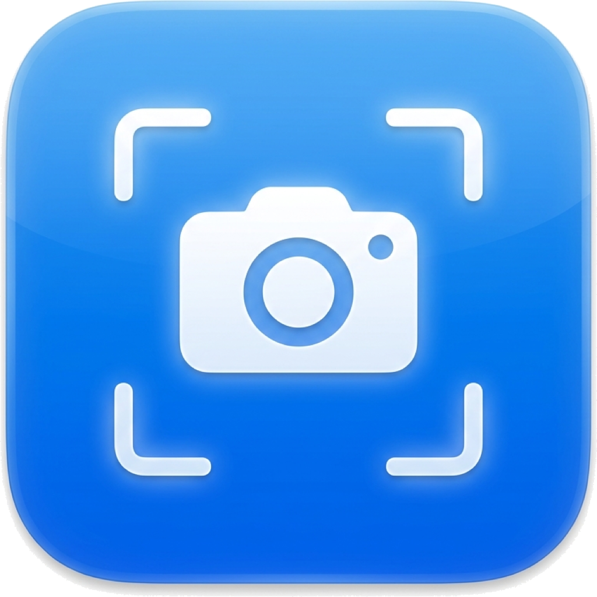
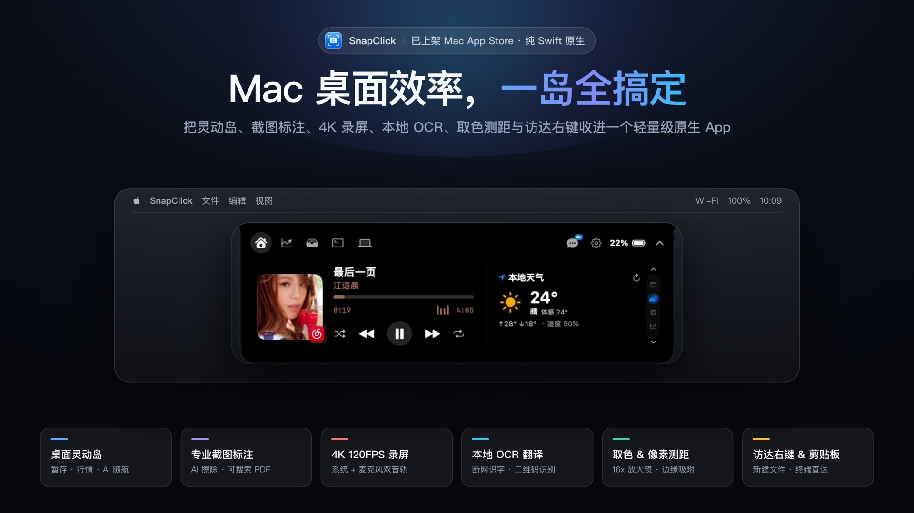
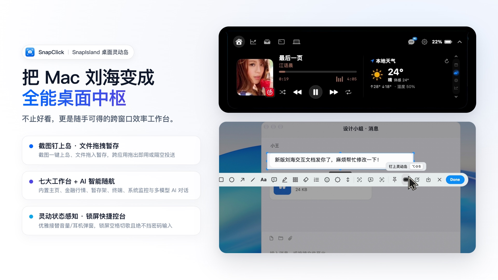
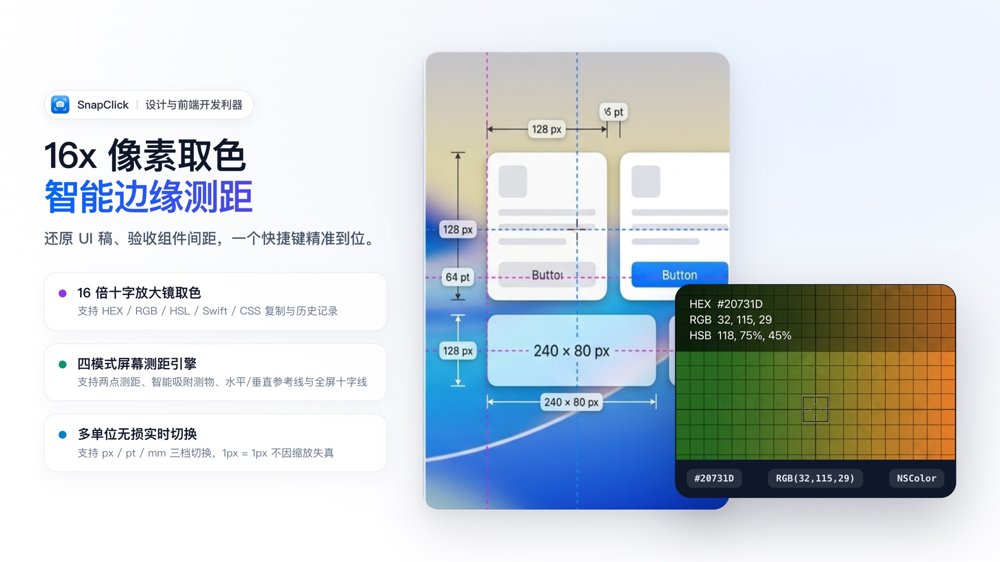
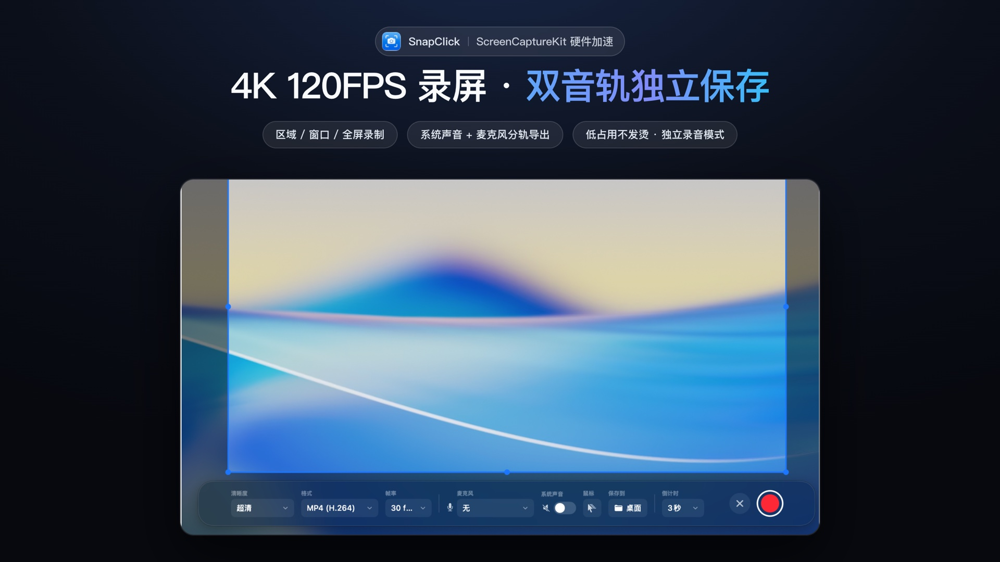
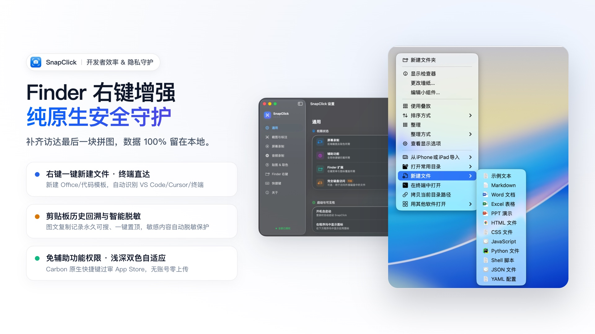

# SnapClick

### All-in-One Native macOS Productivity Suite — Dynamic Island · Screenshot & AI Erase · 4K Recorder · Local OCR · Color & Ruler · Finder Extension

 

  

Declutter your menu bar and stop paying for 8 separate subscriptions. Built purely with native **Swift & SwiftUI**, **SnapClick** unifies a **Mac Dynamic Island (SnapIsland), Pro Screenshot & AI Text Eraser, Searchable PDF Long-Capture, Local OCR & Offline Translation, 4K 120FPS Screen Recorder, 16x Color Picker & Pixel Ruler, Clipboard History, and Finder Right-Click Extension** into one lightweight app. **Now available on the Mac App Store with full App Sandbox verification and automatic updates.**

[At a Glance](#-at-a-glance-1-app-replaces-8) · [Key Features](#-key-features) · [Architecture & Privacy](#-architecture--privacy) · [Download](#-download--install) · [Contact](#-contact--feedback)

[简体中文](README.md) | **English**

 

---

## 📊 At a Glance: 1 App Replaces 8

| Module | Everyday Workflows Covered | Traditional Apps Replaced |
| --- | --- | --- |
| **SnapIsland (Dynamic Island)** | 7 built-in workspaces (Home / Finance / Drop Shelf / Mirror / Terminal / System Monitor / AI Chat) + Live HUD & Lock Screen controls | Alcove / Boring Notch / Dropover |
| **Pro Screenshot & AI Erase** | Smart/Area/Window/Scrolling capture, 14 annotation tools, Spotlight, Watermark, AI text erase, Dual-layer Searchable PDF | CleanShot X / Snipaste / Xnip |
| **Local OCR & Translation** | 100% on-device text extraction, offline translation & QR code scanner | TextSniper / Bob |
| **4K 120FPS Screen & Audio** | Hardware-accelerated ScreenCaptureKit, Area/Window/Full-screen recording, separate System Audio + Mic tracks | Kap / ScreenFlow / QuickTime |
| **16x Color Picker & Ruler** | 16x pixel loupe (HEX/RGB/HSL/Swift/CSS) + Distance / Smart Edge-Snap Measure / Guides / Crosshair | ColorSlurp / Sip / PixelSnap |
| **Finder Right-Click Extension** | New Office/Markdown/Code files from templates, Cut & Paste, Copy Path, Open in Terminal / VS Code / Cursor / Xcode | XtraFinder / Right-Click Tools |
| **Clipboard History & Pin** | Searchable text/image clipboard history with pinning & sensitive data masking, multi-window floating image pins | Paste / Maccy |

---

## ✨ Key Features

### 🏝️ SnapIsland — Dynamic Island for Mac

Turn your MacBook notch and top menu bar into a live productivity hub:

- **Pin Screenshots & Drop Shelf**: Pin any capture directly to the island or drag files onto it to stash temporarily—drag out into any app or trigger AirDrop in one click.
- **7 Built-in Workspaces + AI Assistant**: Expand to switch seamlessly between **Home, Finance Ticker (real-time stocks & indices), File Shelf, Camera Mirror, Quick Terminal, System Monitor, and Multi-Model AI Chat** (with code reasoning and voice dictation).
- **Live System HUD & Lock Screen Controls**: Smoothly replaces stock macOS volume/brightness overlays with audio waveforms and AirPods battery status; supports Lock Screen media controls (press Space to control playback while automatically yielding focus when typing your password) plus cute desktop buddy widgets.

---

### 📸 Pro Screenshot · AI Text Eraser · Local OCR

- **Four Capture Modes**: Smart Capture (auto-snaps to hovered windows), Free Area, Window Capture, and seamless Auto-Scrolling Long Screenshot.
- **14 Annotation Tools**: Rectangles, ellipses, arrows, text, freehand pen, numbered steps, pixelate/blur, **Spotlight focus**, **45° tiled text/logo watermarks**, HD stickers, plus glass-shadow & rounded-corner beautification.
- **AI Smart Erase & Replace**: Brush over sensitive text or clutter to cleanly reconstruct the background—no ugly mosaic blocks required.
- **Dual-Layer Searchable PDF**: Export long captures and documents as searchable PDFs supporting native `⌘F` search and text selection.
- **100% On-Device OCR & Offline Translation**: Extract and translate on-screen text or decode QR codes completely offline with zero cloud uploads.

---

### 🎨 16x Pixel Color Picker & Smart Screen Ruler

Built for frontend engineers, Apple platform developers, and UI designers:

- **16x Crosshair Color Loupe**: Inspect exact screen pixels and copy **HEX, RGB, HSL, Swift (`NSColor`), or CSS** in one click, backed by a recent color history.
- **4-Mode Screen Measuring Engine**: Switch between **Distance**, **Object Measure (smart edge snapping to windows & UI elements)**, **Persistent Guides (horizontal/vertical)**, and **Full-Screen Crosshair**.
- **Multi-Unit Precision**: Toggle seamlessly between `px`, `pt`, and `mm` with true 1:1 display coordinate accuracy.

---

### 🎥 4K 120FPS Hardware-Accelerated Recorder & Audio Capture

- **Native ScreenCaptureKit Engine**: Leverages Apple's official hardware-accelerated pipeline for ultra-low CPU/memory footprint—record high frame rates without spinning up your fans.
- **Flexible Modes & High FPS**: Record Custom Area, Specific Window, or Full Screen at **30 / 60 / 120 FPS** in H.264 or HEVC up to lossless native resolution.
- **Dual Independent Audio Tracks**: Capture system audio and microphone simultaneously as separate tracks for effortless post-production mixing in Final Cut Pro or Premiere.
- **Floating HUD & Standalone Audio Recorder**: Pause, resume, or stop from a sleek floating pill; includes a dedicated audio recorder with customizable sample rate, bitrate, and format.

---

### 🔧 Finder Right-Click Extension · Clipboard History · Screen Pin

- **Create Files Instantly**: Right-click anywhere in Finder to create `.txt`, `.md`, `.docx`, `.xlsx`, `.pptx`, `.html`, `.css`, `.js`, `.py`, `.sh`, `.json`, `.yaml`, or your own custom templates.
- **Developer Tools Direct Launch**: Auto-detects installed tools so you can open the current directory directly in **Terminal, iTerm2, VS Code, Cursor, Warp, Xcode, or JetBrains IDEs**; includes intuitive Cut & Paste and full/POSIX path copying.
- **Clipboard History Manager**: Search and pin text & image clipboard history with automatic sensitive-data masking.
- **Floating Pin Windows**: Keep reference screenshots pinned above all windows across Spaces with scroll-wheel opacity control and double-click zoom.

---

## 🛡️ Architecture & Privacy

- **Zero Accessibility Permission for Global Shortcuts**: Built on Apple's native Carbon `RegisterEventHotKey` API—instant global shortcuts **without ever asking for high-risk macOS Accessibility permissions**, fully compliant with Mac App Store App Sandbox guidelines.
- **Pure Swift & SwiftUI Performance**: Native Apple Silicon optimization with automatic Light/Dark appearance; Finder extension menu icons are cached in `NSCache` for `< 5ms` launch latency.
- **100% Local-First Privacy**: Screenshots, OCR, translations, measurements, and clipboard history stay entirely on your Mac. No account required. Zero telemetry or cloud tracking.

---

## 📥 Download & Install

### Option 1: Mac App Store (Recommended)

Search **`SnapClick`** on the **Mac App Store** or click below for Apple-notarized security, sandbox protection, and automatic updates:

### Option 2: GitHub Releases

Check the [Releases page](https://github.com/Tyeerth/SnapClick/releases/latest) for release packages.

> **💡 Pricing Transparency**: Essential everyday features are free to use. SnapClick Pro unlocks advanced workflows with flexible low-cost plans or a one-time Lifetime purchase—no predatory subscriptions.

### ⚙️ First-Launch Permissions (On-Demand)

Grant only what you use:

1. **Screen Recording**: Required for screenshots, scrolling capture, screen recording, local OCR, and the 16x color loupe.
2. **Finder Extension**: Enable `FinderExtension` in **System Settings → General → Login Items & Extensions → Finder Extensions** to activate right-click enhancements.

*(No Accessibility permission is required for global shortcuts.)*

---

## 📮 Contact & Feedback

Have a bug report, feature request, or suggestion? Reach out anytime:

- **GitHub Issues**: <https://github.com/Tyeerth/SnapClick/issues>
- **Privacy Policy**: <https://tyeerth.github.io/snapclick-privacy/privacy.html>
- **Email**: <tyeerth@163.com>

---

## 📄 License

Licensed under the [Apache License 2.0](LICENSE).
